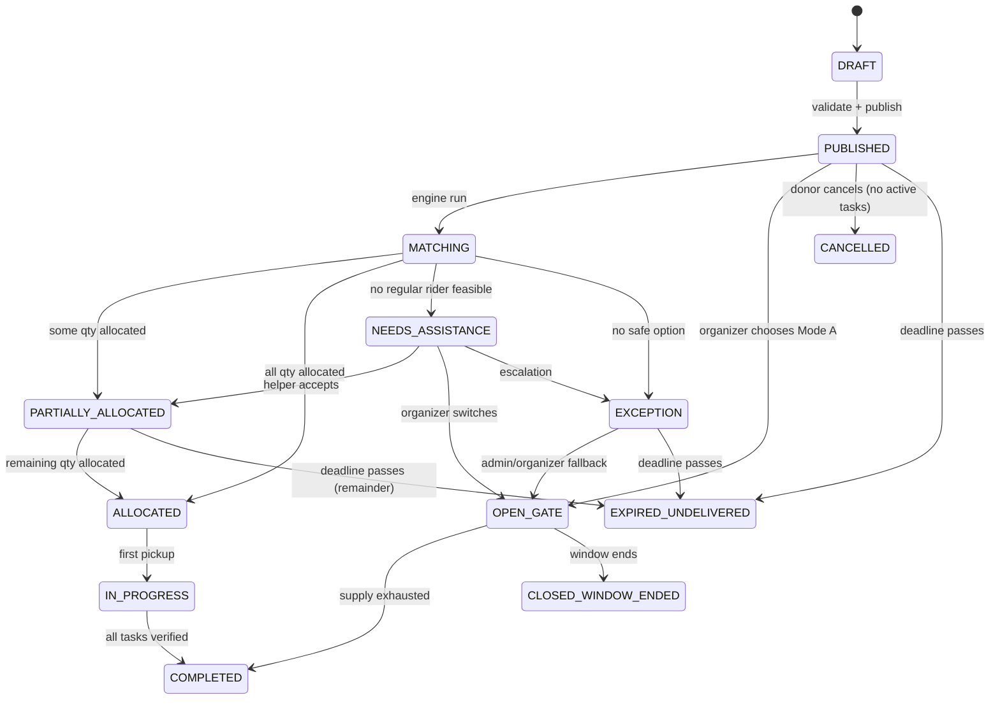
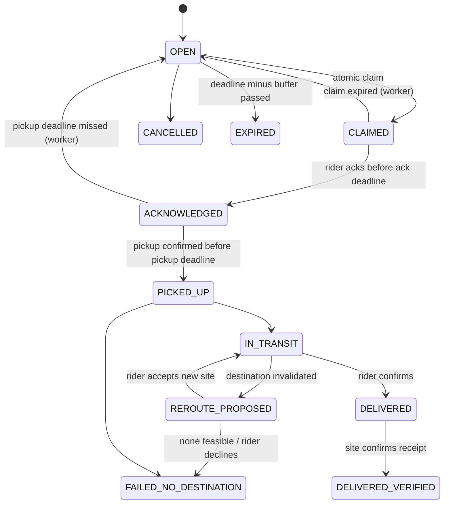

# LastMile Aid — Smart Surplus Food & Emergency-Aid Coordination Platform

**Product Requirements Document (PRD)**

| Field | Value |
| --- | --- |
| Version | 1.0 (hackathon MVP baseline) |
| Status | Draft for team implementation |
| Document type | Implementation-ready PRD |
| Audience | Student dev team, AI coding agents, judges |
| Time zone convention | All stored timestamps in UTC (ISO 8601); UI renders in the user's local zone |
| Scope note | Nothing in this PRD claims that code, tests, deployments, integrations or measured results already exist. Every target is a design goal. |

---

## 1. Executive Summary

LastMile Aid is a responsive web platform that coordinates time-sensitive surplus food and essential supplies between donors, volunteer riders, emergency public helpers, verified NGOs/shelters and administrators.

It is deliberately **not** a generic donation listing site. Its core is a **deterministic dispatch engine** that handles:

- **Expiry pressure** (FEFO: First Expiring, First Out, with a safety buffer).
- **Capacity constraints** (rider carrying capacity, shelter unmet demand).
- **Safety compatibility** (item requirements vs. site capabilities such as clean water, cooking fuel, refrigeration).
- **Volunteer unreliability** (time-limited claims, backend-enforced expiry, automatic release).
- **Operational change** (shelter becomes full mid-delivery, rider unresponsive, zero volunteers) with feasible rerouting or an explicit exception, never a false success.

The MVP proves the critical operational scenarios end to end, driven by an **Admin Simulation Console** that executes real backend business logic.

### 1.1 What the MVP must prove

1. A 180-meal donation is split into feasible, capacity-respecting, demand-respecting delivery tasks.
2. A ghost claim expires and the task returns to the pool.
3. A full shelter triggers a feasible reroute, or an explicit "no safe option" exception.
4. Incompatible item-to-site assignments are rejected by the backend.
5. Credits are awarded exactly once, only after verified events.
6. An organizer can fall back to Open Gate (walk-in) distribution.

---

## 2. Problem Statement

Cities, colleges, hostels, restaurants, wedding functions, pharmacies, NGOs, shelters and relief camps often hold surplus food or essentials that could help people in need. Preventable waste occurs because:

| # | Failure mode | Operational consequence |
| --- | --- | --- |
| P1 | Donation exceeds one rider's capacity | Donation stalls or is partially wasted |
| P2 | One shelter cannot consume/store the whole donation | Over-delivery, spoilage |
| P3 | Volunteer claims then disappears | Task blocked, food ages |
| P4 | Food expires while waiting | Direct waste |
| P5 | Shelter fills after rider departs | Rider stranded with perishables |
| P6 | Raw food sent to sites without water/fuel/refrigeration | Unusable or unsafe delivery |
| P7 | No real-time coordination between actors | All of the above |

> **Assumption A-1.** Any wastage figure quoted in the original problem statement is a **supplied problem assumption**, not a verified statistic. This PRD does not cite, rely on, or reproduce any baseline percentage. Impact in the prototype is measured only from data the prototype itself records.

---

## 3. Product Vision

A civic-tech coordination layer that prioritises **feasible, safe, timely deliveries** over maximising the count of assigned orders. It connects five actor groups: donors, volunteer riders, emergency public helpers, verified NGOs/receiving shelters, and administrators.

Dispatch decisions consider: expiry deadline, available quantity, rider capacity, site demand, item handling requirements, estimated travel time, volunteer availability, live site status, and reassignment feasibility.

**Explicit design stance:** the system *coordinates* aid. It does **not** certify food or medical supplies as safe. Donors declare handling data; sites declare capabilities; the platform enforces compatibility rules over those declarations.

---

## 4. Goals and Non-Goals

### 4.1 MVP Goals (measurable prototype outcomes)

These are **design goals measured inside the prototype/demo**, not real-world impact claims. No baseline statistics are invented.

| ID | Goal | Prototype metric (measured from platform data) | Design target |
| --- | --- | --- | --- |
| G1 | Reduce preventable wastage | Count and quantity of donations ending `EXPIRED_UNDELIVERED` vs. total in a seeded run | Zero silent expiries; every at-risk donation produces an exception or fallback |
| G2 | Minimize post-to-collection time | Median seconds from `PUBLISHED` to first `CLAIMED` in the demo | Reported, no fixed claim |
| G3 | Prevent duplicate / indefinite reservation | Concurrent-claim test; stale-claim release latency | Exactly one winner; release within one worker interval (default 30 s) after claim expiry |
| G4 | Maximize verified handoffs | Ratio of `DELIVERED_VERIFIED` to `ASSIGNED` tasks | Reported |
| G5 | Prevent shelter over-allocation | Invariant test + DB constraint | 0 violations |
| G6 | Enforce item-to-site compatibility | Rejected-assignment test | 100% of incompatible assignments rejected server-side |
| G7 | Recover from rider/site failure | Scenario pass rate in simulation console | All scripted scenarios end in reroute, reassignment, Open Gate fallback or explicit exception |
| G8 | Transparent impact tracking | Ledger-derived totals on dashboards | Totals reconcile to the ledger |

### 4.2 Non-Goals (MVP)

- Real payments or financial processing (donation **intent** only).
- Live GPS tracking and production route optimisation.
- Food-safety certification, medical dispensing or prescription handling.
- AI/ML prediction or generative features (rule-based engine is sufficient; see §21).
- Native mobile apps, SMS/WhatsApp delivery (documented as optional integrations only).
- Claiming any real-world reduction in waste.

---

## 5. Personas, Roles and Permissions

### 5.1 Role summary

| Role | Primary goals | Dashboard | Key workflows |
| --- | --- | --- | --- |
| **Donor** | Safely offload surplus before expiry | Donor dashboard | Create donation → choose mode → track → view credits |
| **Volunteer Rider** | Complete feasible, well-defined deliveries | Volunteer dashboard + task board | Set availability/capacity → claim → acknowledge → pickup → deliver |
| **Emergency Public Helper** | Help when regular coverage fails | Emergency-helper interface | Opt in → receive alert → one-time accept → verified completion |
| **NGO / Shelter Operator** | Receive what they can actually use | Shelter operations dashboard | Declare demand/capacity/resources → monitor incoming → confirm receipt |
| **Administrator** | Keep operations safe and auditable | Admin console + audit log | Verify orgs → monitor risk → handle exceptions → run simulations |

### 5.2 Permission matrix

`C` create, `R` read, `U` update, `D` delete, `own` = own records only, `—` none.

| Resource | Donor | Rider | Helper | NGO Operator | Admin |
| --- | --- | --- | --- | --- | --- |
| Own profile | CRU own | CRU own | CRU own | CRU own | R all, U status |
| Donation | CRU own, cancel own pre-claim | R eligible only | R eligible emergency only | R incoming to own site | R all, override (logged) |
| Allocation / task | R own donation's | R eligible, claim | R emergency-eligible, claim once | R incoming to own sites | R all, override (logged) |
| Delivery events | R own donation's | C on own tasks | C on own tasks | C receipt on own site | R all |
| Receiving site (demand/status/capabilities) | R public fields | R public fields | R public fields | CRU own sites | R all, U verification |
| Organization verification | — | — | — | Submit | Approve/reject |
| Open Gate listing | CRU own | R | R | CRU own | R all, close |
| Credit ledger | R own | R own | R own | R own (if donor) | R all, manual adjust (logged) |
| Notifications | R/mark own | R/mark own | R/mark own | R/mark own | R own + broadcast |
| Simulation console | — | — | — | — | Full (or demo-mode flag) |
| Audit log | — | — | — | — | R |

**Rules**

- RBAC is enforced on the **server** (Express middleware + Postgres Row Level Security where Supabase is used). UI hiding is cosmetic only.
- A user may hold multiple roles (e.g. Donor + Rider); the active role is chosen per session but authorization is checked per resource.
- Emergency helpers cannot bypass transport, safety or expiry constraints; they are matched through the *same* feasibility checks as riders.

---

## 6. Core Domain Model, States and Invariants

### 6.1 Donation state machine

Permitted transitions are enforced in a single backend `transition()` function; any other transition returns `409 INVALID_STATE_TRANSITION`.

### 6.2 Delivery-task state machine

### 6.3 Receiving-site status

`OPEN` → `FULL` → `CLOSED` (and back), plus verification status `PENDING | VERIFIED | REJECTED | SUSPENDED`. Only `VERIFIED` + `OPEN` sites are eligible destinations.

### 6.4 Essential invariants (must hold at all times)

| ID | Invariant | Enforced by |
| --- | --- | --- |
| INV-1 | No delivery task is planned or accepted to arrive after the strict deadline (plus buffer logic) | Engine feasibility check + DB check on `eta_utc <= deadline_utc - buffer` at assignment time |
| INV-2 | No duplicate claims on a task | Atomic conditional `UPDATE ... WHERE status='OPEN'` + unique partial index |
| INV-3 | Sum of live allocations per donation ≤ donation quantity | Transactional check with row lock on donation; `CHECK` on remaining quantity |
| INV-4 | Task quantity ≤ assigned rider's declared capacity | Engine + constraint at claim time |
| INV-5 | Site allocated (non-terminal) quantity ≤ site declared unmet demand | Row lock on site demand row; `CHECK (reserved_qty <= demand_qty)` |
| INV-6 | No assignment where item requirements ⊄ site capabilities | Engine + server validation on every assign/reroute |
| INV-7 | A credit event is awarded at most once | Unique constraint `(event_type, subject_id, user_id)` in ledger + idempotency key |
| INV-8 | Every administrative override produces an audit record | Override endpoints write audit in the same transaction |
| INV-9 | Declared expiry/use-by is never extended | No update path permits later `expiry_utc`; DB trigger rejects increases |
| INV-10 | Browser clock is never authoritative | All decisions use server `now()` |

---

## 7. Assumptions, Dependencies and Constraints (summary)

| ID | Assumption / dependency |
| --- | --- |
| A-2 | Teams use free tiers (Supabase, OpenStreetMap tiles, Leaflet); no paid API is required for the prototype. |
| A-3 | If no routing API key is configured, ETAs come from a **clearly labelled deterministic mock** (haversine distance ÷ configured average speed × detour factor). UI shows an "Estimated (mock)" badge. |
| A-4 | Donors and sites self-declare handling and capabilities; admins verify organizations, not food safety. |
| A-5 | Demo runs on seeded data; "live" behaviour is real backend logic against that data. |
| A-6 | Rider locations are coarse/last-known (manual or periodic), not continuous GPS, in the MVP. |
| A-7 | Default safety buffer is configurable (design default: 20 minutes). |

Full risks and limitations appear in §24.
