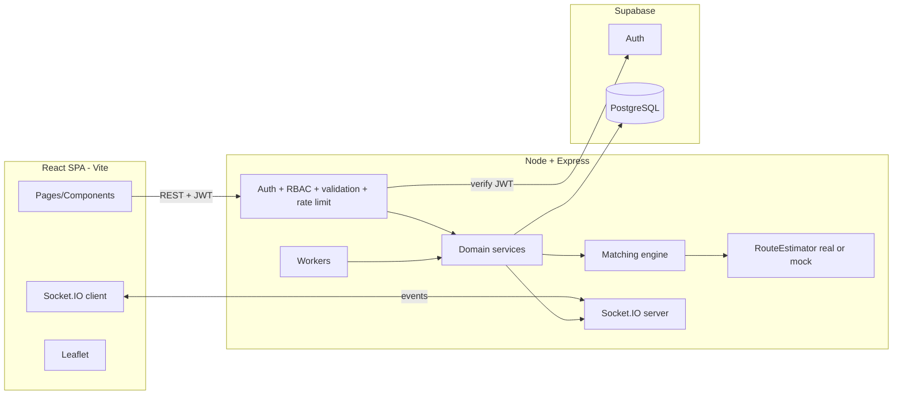

# LastMile Aid — Tech Stack

Baseline for a student hackathon team. Free tiers only; no paid API required. Deployment items are a plan, not a claim of completion.

## 1. Stack at a glance

| Layer | Choice | Purpose | Alternative (only if justified) |
|---|---|---|---|
| Frontend | React + TypeScript + Vite | Fast SPA, type-safe API clients | Next.js if SSR is needed later |
| UI | Tailwind CSS + shadcn/ui | Accessible components, rapid styling | — |
| Backend | Node.js + Express + TypeScript | Business logic, matching engine, workers, RBAC | Fastify |
| Real-time | Socket.IO | Per-user/role/site rooms, auto-reconnect | Supabase Realtime (but authoritative events should come from Express) |
| Database | PostgreSQL via Supabase | Transactions, row locks, constraints | — |
| Auth | Supabase Auth | Email auth, JWTs verified in Express | — |
| ORM / migrations | Prisma | Typed schema and migrations; raw SQL for atomic claims, locks, partial indexes, triggers | — |
| Maps | Leaflet + OpenStreetMap | Free maps, no API key | Follow OSM tile usage policy; make tile URL configurable |
| Charts | Recharts | Impact dashboards | — |
| Validation | zod | Server-side request validation (shared types) | — |
| Scheduling | node-cron / setInterval + Postgres advisory lock | Claim expiry, listing closure, expiry sweeper, matching tick | — |
| Testing | Vitest, Supertest, Playwright | Unit, API/integration + concurrency, E2E | — |
| VCS / CI | Git + GitHub, GitHub Actions | Lint, type-check, tests on PR | — |

## 2. Why this stack fits

- **One language (TypeScript)** across frontend, backend and shared types reduces integration bugs for a small team.
- **Postgres** is the key choice: the hardest requirements (no double claims, no over-allocation, no duplicate credits) are solved with row locks, conditional updates, `CHECK` and `UNIQUE` constraints, not application code alone.
- **Express owns all business rules.** The browser is untrusted: it never decides dispatch, time, or authorization.
- **Rule-based matching** (no ML) because constraints are hard, explainable rules.

## 3. Boundaries

| Concern | Frontend | Backend |
|---|---|---|
| Validation | UX hints only | Authoritative (zod) |
| Time | Display with server-time offset | Authoritative `now()` |
| Authorization | Hides controls | Enforced on every route and socket event |
| Business rules | None | All (engine, invariants, state transitions) |
| Secrets | Public anon values only | Service-role key, DB URL, JWT secret server-only |

## 4. Architecture



## 5. Key technical decisions

1. **Atomic claim** via a single conditional `UPDATE ... WHERE status='OPEN' RETURNING *`; zero rows means `409 ALREADY_CLAIMED`.
2. **Allocation transaction:** `SELECT ... FOR UPDATE` on the donation row, then site-demand rows in ascending id order (avoids deadlocks).
3. **Time:** all timestamps `timestamptz` in UTC; the client countdown is display-only and re-syncs on a `time.sync` socket event.
4. **ETA:** `RouteEstimator` interface. Default `MockRouteEstimator` (haversine × 1.3 detour ÷ 25 km/h + 10 min handling), always labelled "Estimated (mock)"; optional real provider via env.
5. **Realtime:** REST mutates in a DB transaction, then emits after commit; notifications are stored in the same transaction so they survive socket downtime. Events are hints, REST is the source of truth.
6. **Auth:** Supabase JWT verified in Express; RLS enabled as defense in depth; service-role key never reaches the browser.
7. **Idempotency:** `Idempotency-Key` on mutating endpoints; unique constraints on credit events.
8. **Append-only** `audit_logs` and `credit_ledger` (no UPDATE/DELETE grants for the app role).

## 6. Background jobs

| Job | Interval | Action |
|---|---|---|
| claimExpiry | 30 s | Release stale claims, audit, notify, requeue matching |
| listingClosure | 30 s | Close Open Gate listings on window end or exhaustion |
| expirySweeper | 60 s | Mark `EXPIRED_UNDELIVERED`, update urgency, alert |
| matchingTick | 60 s | Re-run engine for at-risk donations |
| helperEscalation | 60 s | Escalate `NEEDS_ASSISTANCE` to Open Gate suggestion or exception |

All can be triggered on demand from the admin simulation console.

## 7. Environment variables (`.env.example`, no real secrets)

```
# Server only
DATABASE_URL=
SUPABASE_URL=
SUPABASE_SERVICE_ROLE_KEY=
SUPABASE_JWT_SECRET=
PORT=4000
DEMO_MODE=false            # true only for local/demo deployments
SAFETY_BUFFER_MINUTES=20
CLAIM_TTL_MINUTES=10
WORKER_INTERVAL_SECONDS=30
ROUTING_PROVIDER=mock      # mock | osrm | custom
ROUTING_API_KEY=

# Client (public values only)
VITE_API_URL=
VITE_SUPABASE_URL=
VITE_SUPABASE_ANON_KEY=
VITE_TILE_URL=https://tile.openstreetmap.org/{z}/{x}/{y}.png
```

## 8. Deployment plan

| Component | Option |
|---|---|
| Frontend | Static host (e.g. Vercel / Netlify) |
| Backend | Always-on Node container on a free tier (e.g. Render / Railway / Fly) — needed for workers and sockets |
| Database + Auth | Supabase project |
| CI | GitHub Actions: lint, type-check, unit + integration tests |

## 9. Local development

```
npm install
cp .env.example .env
npx prisma migrate dev
npm run db:seed        # seeded demo data
npm run dev            # frontend + backend
npm run demo:reset     # reset demo data
npm test               # Vitest + Supertest
npx playwright test    # E2E
```

> Commands above are the intended interface; they exist only once the team implements them.

## 10. Out of scope for the MVP

Live GPS, production route optimisation, push/SMS/WhatsApp, real payments, native apps, ML-based forecasting.
